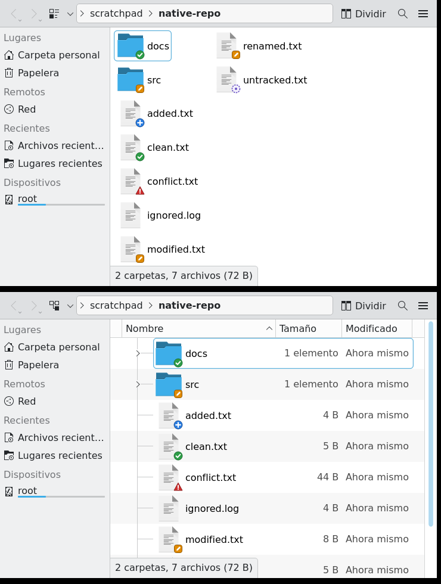
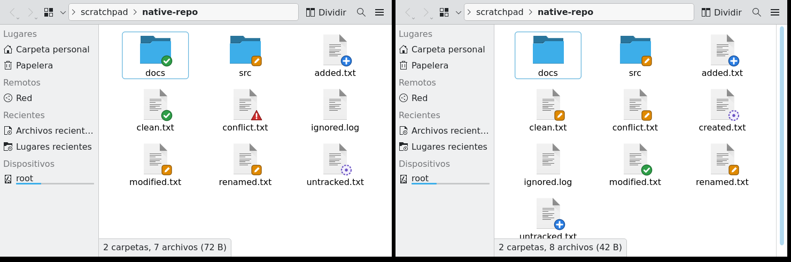
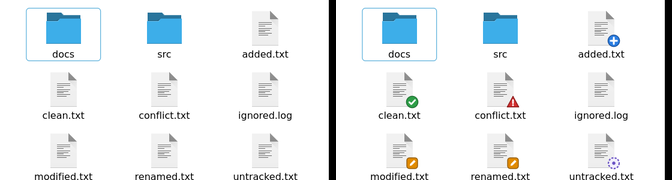

# Dolphin Icon Overlays

Implementation status: the overlay plugin, its client cache, the D-Bus transport, the daemon
provider, and the first icon set are implemented and covered by automated tests. **They have not
been verified in the Plasma Wayland session**, and measurements on large trees are still open. A
real Dolphin 6 was driven on Qt's `vnc` platform (isolated bus, config, and data) with the built
plugin and daemon; see [Native verification](#native-verification). Remaining Phase 3 gates are
listed in
[overlay-status-design.md](overlay-status-design.md#verification-and-remaining-empirical-gates).

## How it works

Dolphin loads `linuxgitshell_overlayicon.so` from `kf6/overlayicon` and calls
`KOverlayIconPlugin::getOverlays(url)` on its main thread while painting. The plugin therefore does
nothing but a bounded in-memory lookup:

1. `getOverlays()` accepts only local `file:` URLs, normalizes the path, and looks it up in the
   process-wide `OverlayClient` cache (4,096 keys, least recently used eviction). A fresh `Ready`
   entry returns its emblem name; anything else returns an empty list and queues a request.
2. Requests leave from the event loop, in batches of at most 256 paths and at most four at a time,
   to `org.linuxgitshell.Experimental.Overlays1` served by `linuxgitshell-daemon`. The first request
   activates the daemon by name; constructing the plugin or painting never does.
3. The daemon runs Git once per repository (status plus tracked-path inventory), not per icon, and
   pushes records back as unicast D-Bus signals. The client turns them into `overlaysChanged(url,
   icons)` so that views repaint or clear the item. Icons also disappear on their own when their
   30-second freshness lapses, so an idle view never keeps a stale emblem.
4. The client renews every retained key every 30 seconds (the daemon's lease is 90 seconds), retries
   failures with 1, 2, 4, … up to 30 second backoff, and clears everything when the daemon goes away
   or is replaced. Signals are accepted only from the bus-verified owner of the service name.

Nothing is shown for items outside a repository, inside bare or sparse-checkout repositories, under
`/proc`, `/sys`, `/dev`, `/run`, or on network or unclassified filesystems.

## Icons

| State | Emblem name | Shape |
| --- | --- | --- |
| Clean | `emblem-linuxgitshell-clean` | green circle, check mark |
| Modified (also renamed, type-changed) | `emblem-linuxgitshell-modified` | orange rounded square, pencil |
| Added (also copied) | `emblem-linuxgitshell-added` | blue circle, plus |
| Conflict | `emblem-linuxgitshell-conflict` | red triangle, exclamation mark |
| Untracked | `emblem-linuxgitshell-untracked` | dashed ring, dot |

Folders show the highest-ranking state below them (`Conflict` > `Modified` > `Added` > `Untracked`
> `Clean`). Deleted and ignored items are modeled but have no glyph yet, so they show nothing and
are never shown as clean. The icons are installed under `hicolor/scalable/emblems`; icon themes can
override them by name. See [licensing.md](licensing.md#icons).

## Configuration

Settings use KConfig in `~/.config/linuxgitshellrc`:

```ini
[Overlays]
Enabled=false
```

Overlays are on by default when the plugin is installed. The setting is read when Dolphin loads the
plugin, so restart Dolphin after changing it. A disabled start-up sends no request, starts no
timer, and never activates the daemon. Live reload and a settings interface belong to the Settings
GUI phase.

Folder propagation is a separate daemon-side setting, independent of `Enabled`:

```ini
[Overlays]
RecursiveFolders=false
```

It defaults to `true`: a folder shows the highest-ranking state below it. With `false`, ordinary
folders show nothing, while explicit untracked or ignored directories and submodule entries keep
their own state. The daemon reads it once at start-up, so stop the running daemon (for example
`pkill linuxgitshell-daemon`) and let the next overlay request activate a new one.

## Trying it

```bash
cmake -S . -B build -DCMAKE_BUILD_TYPE=Debug -DCMAKE_INSTALL_PREFIX=$HOME/.local
cmake --build build -j && cmake --install build
kquitapp6 dolphin; dolphin /path/to/a/repository
```

Debug logging for the plugin and daemon: `QT_LOGGING_RULES="linuxgitshell.*.debug=true"` (add
`QT_FORCE_STDERR_LOGGING=1` when the journal would otherwise capture it). Logs contain counts,
durations, and error categories, never paths. Remove the plugin with `cmake --build build --target
uninstall` if your build generates it, or delete the installed `linuxgitshell_overlayicon.so`, the
`emblem-linuxgitshell-*.svg` files, and the two `org.linuxgitshell.Experimental.*.service` files.

## Native verification

Checked on 2026-11-21 against a disposable fixture repository, with an unmodified Dolphin loading
the installed plugin and a daemon activated on a private session bus. Screenshots come from a custom
RFB client attached to Dolphin's `vnc` platform plugin, so Breeze icons render but the Plasma shell
is absent.

- All five states (clean, modified, added, conflict, untracked) and the clearing of a state repaint
  correctly in the icons, details, and compact views, with folders showing the highest-ranking
  state below them.
- Scripted changes to the fixture repository (several mutation rounds) update the open window without
  restarting Dolphin.
  Lease expiry clears emblems when the daemon stops being reachable, and a restarted daemon is
  picked up again by the client's backoff.
- `[Overlays] Enabled=false` shows no emblems and never starts the daemon.
  `RecursiveFolders=false` removes folder emblems and keeps file emblems.





Not verified yet: two Dolphin windows, folder scaling, a local external mount, network-mount
exclusion on a real mount, Dolphin paint-callback latency, and anything on the real Plasma Wayland
session. Daemon-level latency on a 100k-file tree is measured below. The `RefreshRepository` hook is not wired to the
application.

## Measurements on a 100k-file fixture

Measured on 2026-11-21 against the real daemon, activated on a private session bus, by a scripted
D-Bus client that renews its lease every 30 s like the plugin. Fixture: a disposable repository of
100,152 tracked files in 1,000 directories plus a 40-level-deep path, with 200 modified, 100
untracked, and 50 ignored files, on tmpfs with a warm page cache (4 CPU threads, default limits:
15 s poll, 250 ms debounce). Raw Git on the same tree: `git status --porcelain=v2 -z` 0.23 s wall
(1.9 MB output), `git ls-files -z` 0.02 s.

| Measurement | Result |
| --- | --- |
| `RequestOverlays` call returns (cold, 100 paths) | 20 ms |
| Cold: request to the first and only batch of Ready records (resolution, status, inventory, index build) | 1.4 s (two runs: 1.40 s, 1.44 s) |
| Warm: `RequestOverlays` call returns (20 requests, 100 paths each) | p50 7 ms, max 10 ms |
| Warm: request to all initial records | p50 34-36 ms, p95 44-53 ms, max 51-59 ms (two runs) |
| Edit of an observed file to `OverlaysChanged` (5 samples, spread across the poll phase) | 3.0 to 12.6 s, median 7.9 s (bounded by the 15 s poll plus one refresh) |
| Daemon RSS | 53 MB after the cold load, 82 MB after one minute of polling |
| Daemon CPU while idle, one observed directory | 3.2 s of CPU in 60 s (about 5% of one core), excluding Git children |

Observations: the states returned for the sampled paths matched the fixture (modified, untracked,
ignored, clean, a parent directory reporting a modified child, and the deep path). With the
renewal removed, observations expired after the 90 s lease as designed (an early run without it
stopped receiving changes), so renewal matters for long-lived views.

Caveats: this measures the daemon and the D-Bus path, not Dolphin's paint callback (the plugin
returns from the cache without Git or bus work; its cold-callback bound is covered by
`dolphin.overlay_plugin`). tmpfs hides disk latency and a warm cache hides cold-cache Git cost.
The idle cost is real: each poll of a 100k-file repository rebuilds its index, so
the 15 s default is a candidate for tuning or for a cheaper change check. Only one fixture size
was run, there was no external or network mount, no p50/p95 of callback time, no comparison with
Git's untracked cache or fsmonitor, and no run on the Plasma session.

## Automated coverage

| Test | Covers |
| --- | --- |
| `dolphin.overlay_client` | cache, deferred requests, batching, generations, revisions, freshness, backoff, eviction, disabling |
| `dolphin.overlay_client_dbus` | the real daemon by activation: real states, spoofed senders, service loss and recovery, absent service, release |
| `dolphin.overlay_plugin` / `_disabled` | the built module loaded like KIO does, 10,000 cold callbacks with no Git or bus work, disabled-by-settings run |
| `daemon.overlay_provider`, `daemon.overlay_dbus`, `daemon.overlay_settings` | provider, service, and settings side |
